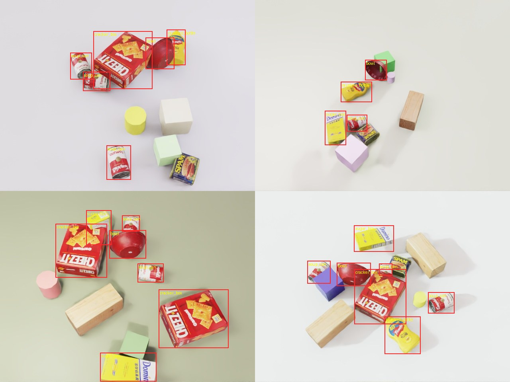
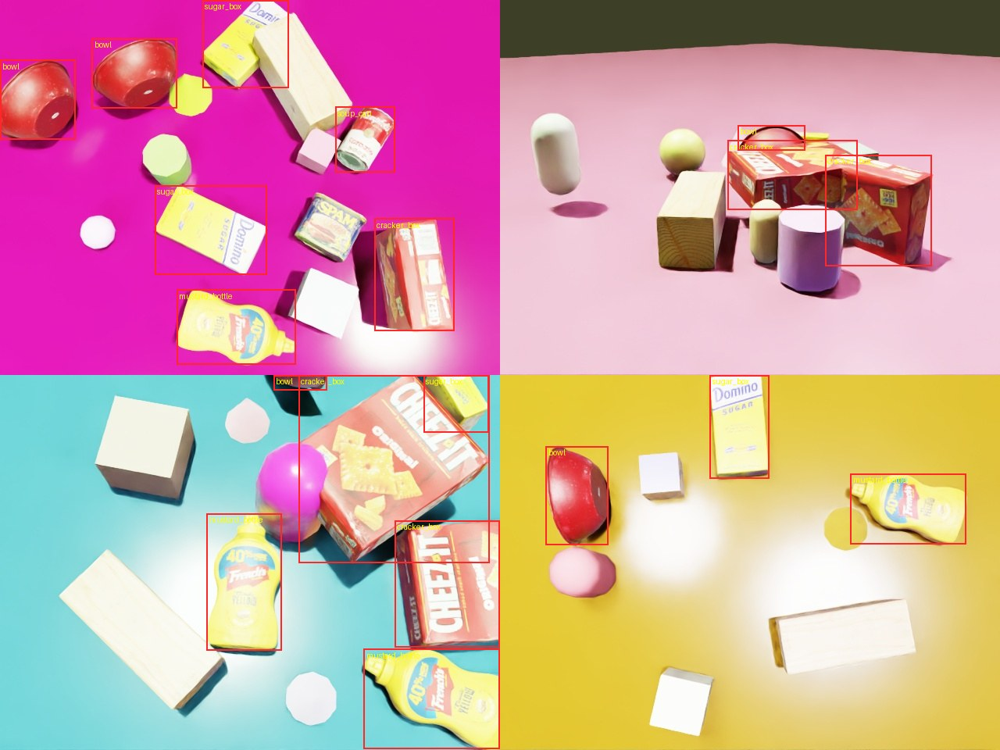
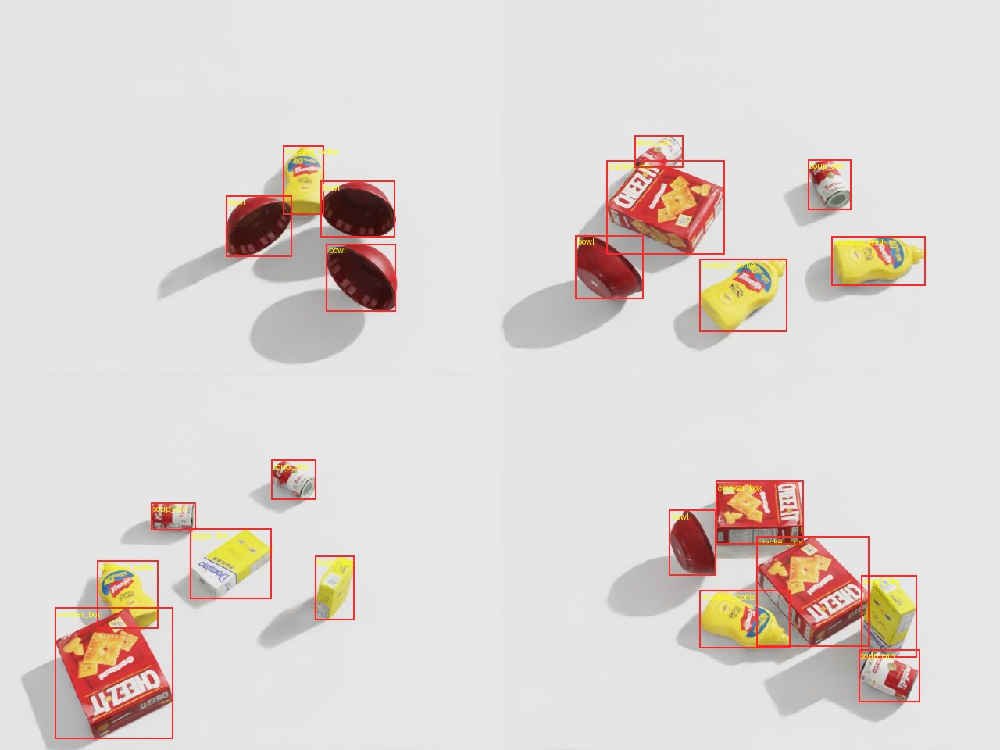

# isaac-synthetic-yolo

Synthetic training data from NVIDIA Isaac Sim (Replicator) for a YOLO11n detector, with one experiment: does domain randomization help when the test images look different from the training images? The detector is trained on rendered images only and scored on rendered images only. There are no real photos here.

Author: Ha Phan Thanh Hai. License: MIT (code). The object meshes are Isaac Sim's sample YCB assets, fetched from NVIDIA's asset server at run time and not committed.



## What it does

- `gen_data.py` builds a tabletop scene in Isaac Sim 5.1.0 (headless) with 5 labelled classes from the YCB set (`cracker_box`, `sugar_box`, `soup_can`, `mustard_bottle`, `bowl`). Each frame places 3 to 7 of them at random on the table, some boxes lying on their side, and writes a 640x480 JPEG plus a YOLO label file. Boxes come from the Replicator `bounding_box_2d_tight` annotator; I drop boxes that are over 80% occluded or under 6 px on a side.
- Three modes:
  - `rand`: randomizes camera pose and focal length, dome / sun / point light intensity and colour, table colour and roughness, and adds 2 to 5 unlabelled distractors (cube, sphere, cylinder, wood block, potted meat can) with random colours.
  - `fixed`: the baseline. One camera, one light setup, one grey table, no distractors. Object placement is still random, otherwise every image would be identical.
  - `shift`: the held-out robustness set. Ranges sit outside the `rand` ranges: closer (0.7 to 0.9 m) and farther (1.9 to 2.4 m) cameras at low (12 to 28 deg) or near top-down (75 to 88 deg) elevation, very dark or very bright and strongly tinted lighting, long low-angle shadows, dark saturated glossy table, 5 to 8 distractors including two shapes never seen in `rand` (cone, capsule).
- `train_eval.py` fine-tunes YOLO11n (COCO-pretrained `yolo11n.pt`) for 30 epochs and evaluates the final weights on all three eval sets.
- `yolo_labels.py` holds the pixel-box to YOLO conversion (tested in `tests/test_labels.py`). `draw_samples.py` draws labels on images for the sample sheets. `aggregate.py` builds the table below from `results/*.json`.

## Results

Data: 2000 train images per training set, 300 images per eval set, 640x480. Eval sets: `fixed_val` (same distribution as the baseline's training set), `rand_val` (same distribution as the randomized training set, different seed), `shift_test` (the shifted set). Each cell is the mean of 2 training seeds, with the min-max range of mAP50-95 in brackets. Raw per-run numbers: `results/*_s*.json`.

| Train set | Ultralytics augmentation | fixed_val mAP50 / mAP50-95 | rand_val mAP50 / mAP50-95 | **shift_test mAP50 / mAP50-95** |
|---|---|---|---|---|
| fixed (no randomization) | default | 0.995 / 0.987 (0.987-0.988) | 0.933 / 0.886 (0.880-0.892) | **0.758 / 0.583** (0.580-0.586) |
| randomized | default | 0.995 / 0.982 (0.981-0.983) | 0.995 / 0.973 (0.971-0.975) | **0.977 / 0.894** (0.892-0.895) |
| fixed (no randomization) | off | 0.995 / 0.983 (0.982-0.984) | 0.900 / 0.830 (0.827-0.834) | **0.593 / 0.436** (0.411-0.461) |
| randomized | off | 0.995 / 0.979 (0.979-0.980) | 0.994 / 0.959 (0.958-0.961) | **0.938 / 0.833** (0.829-0.836) |

"Augmentation off" turns off Ultralytics colour jitter, mosaic, scale/translate jitter, flips and erasing, so only the dataset differs. "Default" keeps them, which is what most people actually run.

What this shows:

- Training on a single camera/lighting/background gets 0.58 mAP50-95 on the shifted set against 0.89 with randomization, with identical image counts and training settings. With augmentation off the gap is 0.44 vs 0.83. The seed-to-seed spread (0.002 to 0.05) is much smaller than the gap.
- The baseline is as good as the randomized model on its own distribution (0.987 vs 0.982 on `fixed_val`). In-distribution scores do not reveal the problem; only a shifted set does.
- Ultralytics' default augmentation recovers part of the gap for the baseline (0.44 to 0.58) but not most of it.
- Randomization costs a little in-distribution accuracy (0.982 vs 0.987, near the noise) and does not close the whole shift gap: 0.894 on `shift_test` against 0.973 on `rand_val`.
- mAP50 is saturated at 0.995 on several rows, so mAP50-95 is the number that discriminates.

## Generation throughput

Isaac Sim 5.1.0, headless, `rt_subframes=4`, one frame per step, RTX 5070. Numbers include randomization, rendering, annotator read-back and writing the JPEG and label file; they exclude app start-up (about 10 s) and the first-time asset download.

| Set | Images | Seconds | Images/s |
|---|---|---|---|
| rand train | 2000 | 131 | 15.3 |
| rand val | 300 | 20 | 15.2 |
| shift test | 300 | 20 | 14.7 |
| fixed train | 2000 | 121 | 16.5 |

(`results/gen_*.json` has exact values and per-class box counts: about 10,000 boxes in each 2000-image training set, about 1,460 in the shifted set.) Training: 30 epochs of 2000 images took about 2.3 minutes per run (`yolo11n`, batch 32, 640 px).

## Reproduce

Hardware used: Intel i9-14900KF, NVIDIA RTX 5070 12 GB (driver 580.173), Ubuntu 22.04, Isaac Sim 5.1.0 standalone (binary package, run with `./python.sh`), Python 3.10 venv with torch 2.11.0+cu128 and ultralytics 8.4.203 for training. The Blackwell GPU needs a cu128-or-newer torch build. The machine was shared, so everything ran under `nice` with 4 CPU threads.

```bash
# 1. data (Isaac Sim's python; needs internet the first time for the YCB assets)
OMP_NUM_THREADS=4 sh gen_all.sh          # paths inside assume ~/isaacsim; ~8 min
# 2. training + ablation (venv with torch cu128 + ultralytics)
pip install -r requirements.txt
sh run_ablation.sh                        # 8 runs, ~30 min total
python aggregate.py                       # markdown table from results/
# 3. unit test (no GPU / Isaac needed)
pytest -q tests
# 4. sample sheets with labels drawn
python draw_samples.py data/shift_test samples/shift_test.jpg 4
```

Seeds: datasets use seeds 0 to 4 (see `gen_all.sh`), training uses seeds 0 and 1.

## Samples

Boxes are the exported YOLO labels drawn back on the images. Randomized training frames are at the top of this page.

Shifted test set (`samples/shift_test.jpg`), conditions the randomized model never saw:



Baseline training set, a single viewpoint and light (`samples/fixed_train.jpg`):



## Limitations

- Synthetic only. Training and evaluation both use rendered images from the same renderer. This says nothing direct about performance on real photos; a real sim-to-real claim needs a real labelled test set.
- The shift is in rendering conditions (camera, light, background, distractors). The five object meshes and their textures are the same in every set, so it does not test unseen objects or appearance changes of the objects themselves. Object colours/textures are not randomized, only the table and distractors are.
- I wrote the shifted ranges before training anything and did not tune them afterwards, but they are my own choice; a harder or easier shift would change the gap. Treat the size of the gap as specific to this setup, and the direction as the finding.
- Two training seeds per cell and one dataset seed per set. The ranges are small here, but this is not a significance test.
- The detector starts from COCO-pretrained weights. The classes are easy to separate by colour and shape, which is why in-distribution mAP50-95 is near 0.98.
- No image textures or HDRI backgrounds: the table and distractors use plain coloured materials with random roughness, and the background behind the table is the dome light colour.
- Labels come from the 2D tight bounding box annotator on visible pixels; very occluded objects (over 80%) are dropped from labels, so an occluded-but-visible object can be missing from ground truth. I wrote my own YOLO writer instead of Replicator's `BasicWriter`, because the output needed filtering and a direct format.
- Not tested: other detectors, other epoch counts, fewer images, individual randomization factors (which of camera / light / background matters most).
